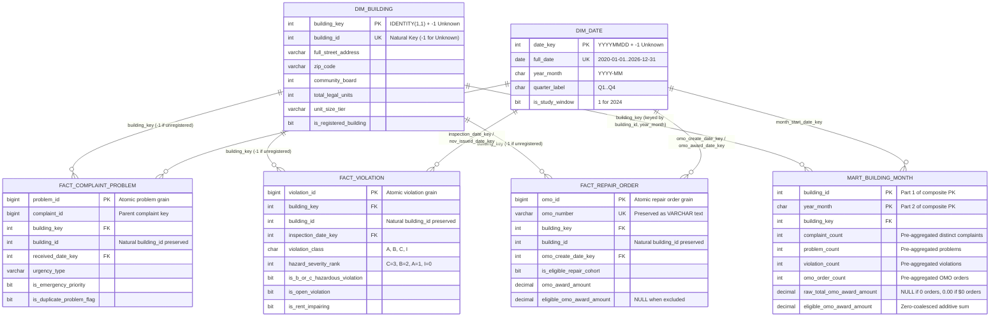

# Gold Layer, Semantic Metrics & Business Analytics Report (`M4`) — HomeRescue AI

## 1. Executive Summary & Core Business Question

The **HomeRescue AI** Gold and Semantic layers (`sql/03_gold.sql`, `sql/04_semantic.sql`, `sql/05_feature_views.sql`, `sql/06_analytics.sql`, and `semantic/metrics.yml`) complete the analytical core of our NYC Housing Maintenance & Repair Data Warehouse in SQL Server (`homerescue_dw`).

### Primary Business Question
> **Which Staten Island (`boroid = 5`) buildings exhibit the highest concentration of documented housing maintenance distress (emergency complaint problems, Class B and Class C hazardous Housing Maintenance Code violations, open violation backlogs, and rent-impairing conditions) during calendar year 2024 (`2024-01-01` through `2024-12-31`), how do HPD Open Market Order (OMO) eligible residential repair contract awards align with those documented hazards across buildings, ZIP codes, building size tiers, and months, and which high-hazard buildings remain unaddressed by eligible OMO repair orders?**

### Strict Evidence & Non-Claim Boundaries (Mandatory Rules 4, 5 & 14)
1. **Contract Award vs. Paid Disbursement:** Every financial figure derived from `omo_award_amount` (`OMOAwardAmount` in `mdbu-nrqn`) represents an **awarded HPD Open Market Order contract/order amount**—not proof of paid invoice disbursement (`emrz-5p35`, deferred) and not a preventive maintenance cost saving.
2. **Eligible Residential Repair Cohort vs. Demolitions:** All `490` Staten Island 2024 OMO orders (`$3,081,609.44`) are retained in `gold.fact_repair_order`, but analytical repair metrics filter `is_eligible_repair_cohort = 1` (`458` residential repair orders totaling **`$983,560.44`** across `204` buildings) to prevent `9` commercial/structural demolition orders (**`$2,097,799.00`**, `68.07%` of raw OMO dollars), `1` duplicate administrative OMO (`$250.00`), and `22` un-awarded `$0.00` orders from distorting residential maintenance analysis.
3. **Descriptive Snapshot Scope:** Building-level feature views (`gold.features_building_maintenance`) and priority rankings (`semantic.v_building_priority_ranking`) are descriptive 2024 analytical snapshots (`feature_snapshot_scope = '2024_ANNUAL_DESCRIPTIVE_SNAPSHOT'`), not trained ML risk probabilities or causal treatment estimates.

---

## 2. Gold Dimensional Model, Grain Declarations & Fan-Out Prevention Architecture

### Gold & Semantic Object Inventory and Row Counts (`homerescue_dw`)

| Layer & Object Name | Object Type | Exact Declared Grain | Primary / Unique Key | Row Count | Unmatched (`building_key = -1`) Rows | Audit Status |
|---|---|---|---|---:|---:|---|
| `gold.dim_building` | Persistent Table | One row per normalized `building_id` (`+1` unknown member) | `PK: building_key`, `UQ: building_id` | **22,330** | `1` (`building_id = -1`) | **PASS** |
| `gold.dim_date` | Persistent Table | One row per calendar date (`2020-01-01`..`2026-12-31` `+1` unknown) | `PK: date_key`, `UQ: full_date` | **2,558** | `1` (`date_key = -1`) | **PASS** |
| `gold.fact_complaint_problem` | Persistent Table | One row per HPD complaint problem (`problem_id`) | `PK: problem_id` | **14,377** | `35` (`building_id = 912070`) | **PASS** |
| `gold.fact_violation` | Persistent Table | One row per HPD HMC violation (`violation_id`) | `PK: violation_id` | **18,463** | `17` (`building_id = 912070`) | **PASS** |
| `gold.fact_repair_order` | Persistent Table | One row per HPD OMO charge (`omo_id`) | `PK: omo_id`, `UQ: omo_number` | **490** | `6` (`4` distinct `building_id`s) | **PASS** |
| `gold.mart_building_month` | Persistent Table | One row per active `(building_id, year_month)` in 2024 | `PK: (building_id, year_month)` | **6,812** | `13` (`4` distinct `building_id`s) | **PASS** |
| `gold.features_building_maintenance` | Feature View | One row per `building_id` across all Staten Island buildings | `building_id` (`22,329` reg + `4` unreg) | **22,333** | `4` (`912070`, `748099`, `888686`, `1012831`) | **PASS** |
| `semantic.metric_catalog` | Catalog Table | One row per governed business metric definition | `PK: metric_name` | **12** | N/A | **PASS** |
| `semantic.v_building_priority_ranking` | Semantic View | One row per `building_id` with priority rank & intervention gap | `building_id` | **22,333** | `4` | **PASS** |
| `semantic.v_monthly_borough_summary` | Semantic View | One row per 2024 calendar month (`year_month`) | `year_month` (`2024-01`..`2024-12`) | **12** | N/A | **PASS** |
| `semantic.v_zip_code_maintenance_summary` | Semantic View | One row per Staten Island `zip_code` | `zip_code` (`12` ZIPs + `UNKNOWN`) | **13** | `1` (`UNKNOWN`) | **PASS** |
| `semantic.v_violation_hazard_breakdown` | Semantic View | One row per `violation_class` (`C`, `B`, `A`, `I`) | `violation_class` | **4** | N/A | **PASS** |
| `semantic.v_omo_repair_cohort_summary` | Semantic View | One row per `(cohort, category, work_type, fin_status)` | Composite cohort key | **24** | N/A | **PASS** |
| `semantic.v_unmatched_building_audit` | Semantic View | One row per unregistered `building_id` (`building_key = -1`) | `building_id` | **4** | `4` | **PASS** |

### Key Architectural Safeguards Enforced in Gold
1. **Persistent Surrogate Keys (`Mandatory Rule 13`):** `gold.dim_building` uses a persistent `IDENTITY(1,1)` surrogate key (`building_key`) and `gold.load_dim_building` updates existing rows in place while inserting only new `building_id` rows (`WHERE NOT EXISTS`), guaranteeing that `building_key` mappings never shift across reruns.
2. **Zero Fan-Out Pre-Aggregation (`Mandatory Rule 7`):** `gold.mart_building_month` and `gold.features_building_maintenance` aggregate `gold.fact_complaint_problem`, `gold.fact_violation`, and `gold.fact_repair_order` **independently** in separate CTEs before joining to the building-month or building spine. As a result, `SUM(total_omo_award_amount) = $3,081,609.44` and `SUM(eligible_omo_award_amount) = $983,560.44` match `silver.omo_charge` to the exact cent.
3. **Unmatched Building Non-Collapse (`Mandatory Rule 12`):** While all `58` unmatched event rows link to `building_key = -1` in `gold.dim_building` for referential integrity, `gold.mart_building_month` and `gold.features_building_maintenance` key on natural `building_id` so the `4` unregistered buildings (`912070`, `748099`, `888686`, `1012831`) remain completely distinct.
4. **Preserving `NULL` vs. `$0.00` Repair Order Semantics:** In `gold.mart_building_month`, `raw_total_omo_award_amount` is `NULL` across the `6,475` active building-months that had **no** OMO orders, `0.00` across the `10` active building-months that had **only zero-dollar** cancelled/un-awarded OMO orders, and `> 0.00` across the `327` building-months with positive OMO awards.

---

## 3. Governed Semantic Metric Catalog & Silver Reconciliation

Synchronized from `semantic/metrics.yml` into `semantic.metric_catalog` via `python -m src.semantic.sync_metrics` and verified via `python -m src.quality.run_checks` (`data/exports/validation/quality_checks_results_homerescue_dw.json`):

| Metric Name (`metric_name`) | Label | Declared Grain | Gold Expression | Observed Gold Value | Observed Silver Validation Value | Status |
|---|---|---|---|---:|---:|---|
| `total_complaint_problems` | Total Complaint Problems | `gold.fact_complaint_problem.problem_id` | `COUNT(f.problem_id)` | **14,377** | **14,377** | **PASS** |
| `distinct_complaints` | Distinct Parent Complaints | `gold.fact_complaint_problem.complaint_id` | `COUNT(DISTINCT f.complaint_id)` | **7,334** | **7,334** | **PASS** |
| `emergency_complaint_problems` | Emergency Priority Complaint Problems | `gold.fact_complaint_problem.problem_id` | `SUM(CASE WHEN f.is_emergency_priority = 1 ...)` | **8,373** | **8,373** | **PASS** |
| `total_violations` | Total HMC Violations & Administrative Orders | `gold.fact_violation.violation_id` | `COUNT(f.violation_id)` | **18,463** | **18,463** | **PASS** |
| `hazardous_bc_violations` | Hazardous Violations (Class B & Class C) | `gold.fact_violation.violation_id` | `SUM(CASE WHEN f.is_b_or_c_hazardous_violation = 1 ...)` | **13,063** | **13,063** | **PASS** |
| `immediately_hazardous_c_violations` | Immediately Hazardous Violations (Class C) | `gold.fact_violation.violation_id` | `SUM(CASE WHEN f.is_immediately_hazardous = 1 ...)` | **4,763** | **4,763** | **PASS** |
| `open_violations` | Open HMC Violations | `gold.fact_violation.violation_id` | `SUM(CASE WHEN f.is_open_violation = 1 ...)` | **5,710** | **5,710** | **PASS** |
| `rent_impairing_violations` | Rent-Impairing Violations | `gold.fact_violation.violation_id` | `SUM(CASE WHEN f.is_rent_impairing = 1 ...)` | **721** | **721** | **PASS** |
| `eligible_repair_order_count` | Eligible Residential Repair Orders | `gold.fact_repair_order.omo_id` | `SUM(CASE WHEN f.is_eligible_repair_cohort = 1 ...)` | **458** | **458** | **PASS** |
| `eligible_omo_award_amount` | Eligible Residential Repair Award Amount ($) | `gold.fact_repair_order.omo_id` | `SUM(f.eligible_omo_award_amount)` | **\$983,560.44** | **\$983,560.44** | **PASS** |
| `avg_eligible_omo_award_amount` | Average Eligible Residential Repair Award ($) | `gold.fact_repair_order.omo_id` | `CAST(AVG(f.eligible_omo_award_amount) AS DECIMAL(18,2))` | **\$2,147.51** | **\$2,147.51** | **PASS** |
| `total_all_omo_award_amount` | Total Raw OMO Award Amount Including Demolitions ($) | `gold.fact_repair_order.omo_id` | `SUM(f.omo_award_amount)` | **\$3,081,609.44** | **\$3,081,609.44** | **PASS** |

---

## 4. Five Core Business Analyses (`sql/06_analytics.sql`)

### Analysis 1 (`Q1A` & `Q1B`): Building Maintenance Review Priority & OMO Intervention Gap
Each building's `maintenance_priority_score` is computed deterministically from documented safety indicators (with Administrative Class `I` assigned weight `0`):
$$\text{Priority Score} = 5(\text{Class C}) + 3(\text{Class B}) + 2(\text{Open Violations}) + 4(\text{Rent-Impairing}) + 1(\text{Emergency Problems})$$

#### Table 1A — Intervention Gap Summary Across All `22,333` Staten Island Buildings (Grain: One row per `intervention_gap_status`)

| `intervention_gap_status` | Buildings | Share of All Buildings | Distinct Complaints | Total Problems | Emergency Problems | Total Violations | Class C Violations | Class B Violations | Hazardous (B+C) Violations | Open Violations | Rent-Impairing Violations | Eligible OMO Orders | Eligible OMO Award Amount |
|---|---:|---:|---:|---:|---:|---:|---:|---:|---:|---:|---:|---:|---:|
| `HIGH_HAZARD_WITH_ELIGIBLE_OMO` (`Score >= 25`, `OMO > 0`) | **137** | `0.61%` | 2,448 | 5,144 | 3,031 | 8,868 | 3,103 | 4,584 | **7,687** | 1,503 | 504 | **376** | **\$751,413.00** |
| **`HIGH_HAZARD_UNADDRESSED_BY_OMO` (`Score >= 25`, `OMO = 0`)** | **339** | `1.52%` | 2,626 | 5,461 | 3,211 | 5,416 | 1,382 | 2,961 | **4,343** | **2,376** | 203 | **0** | **\$0.00** |
| `MODERATE_HAZARD_UNADDRESSED_BY_OMO` (`Score 1-24`, `OMO = 0`) | **2,311** | `10.35%` | 1,748 | 3,176 | 2,078 | 2,892 | 241 | 728 | **969** | 1,811 | 12 | **0** | **\$0.00** |
| `MODERATE_HAZARD_WITH_ELIGIBLE_OMO` (`Score 1-24`, `OMO > 0`) | **34** | `0.15%` | 46 | 84 | 53 | 100 | 37 | 27 | **64** | 20 | 2 | **37** | **\$55,303.34** |
| `LOW_OR_ZERO_HAZARD_NO_OMO` (`Score = 0`, `OMO = 0`) | **19,479** | `87.22%` | 457 | 499 | 0 | 1,182 | 0 | 0 | **0** | 0 | 0 | **0** | **\$0.00** |
| `LOW_HAZARD_WITH_ELIGIBLE_OMO` (`Score = 0`, `OMO > 0`) | **33** | `0.15%` | 9 | 13 | 0 | 5 | 0 | 0 | **0** | 0 | 0 | **45** | **\$176,844.10** |
| **Total Staten Island Spine** | **22,333** | **100.00%** | **7,334** | **14,377** | **8,373** | **18,463** | **4,763** | **8,300** | **13,063** | **5,710** | **721** | **458** | **\$983,560.44** |

> **Key Finding 1 (Extreme Concentration & Unaddressed High-Hazard Backlog):**
> - Just **`476` high-hazard buildings (`2.13%` of Staten Island's `22,333` buildings)** account for **`12,030` of `13,063` (`92.09%`)** of all Class B and Class C hazardous violations and **`707` of `721` (`98.06%`)** of all rent-impairing violations.
> - While `137` of those high-hazard buildings received `376` eligible OMO repair orders (`$751,413.00`, `76.40%` of eligible repair awards), **`339` high-hazard buildings (`HIGH_HAZARD_UNADDRESSED_BY_OMO`)** accumulated **`1,382` Class C violations, `2,961` Class B violations, `2,376` open violations, `203` rent-impairing violations, and `3,211` emergency complaint problems** in 2024 with **zero** eligible OMO repair orders (`$0.00`).

#### Table 1B — Top 15 Priority Buildings in Staten Island (`2024`, Grain: One row per `building_id`)

| Rank | `building_id` | `building_key` | Street Address | ZIP | Legal Units | Active Months | Complaints (`Problems`) | Emergency Problems | Total Violations | Class C | Class B | Open Viol. | Rent-Impairing | Eligible OMOs | Eligible OMO Award | Priority Score | Intervention Status |
|---:|---:|---:|---|---|---:|---:|---:|---:|---:|---:|---:|---:|---:|---:|---:|---:|---|
| **1** | `812537` | `16759` | `185 PARK HILL AVENUE` | `10304` | 150 | 12 | 263 (`481`) | 330 | 846 | 357 | 442 | 19 | 55 | 31 | \$43,348.25 | **3,699** | `HIGH_HAZARD_WITH_ELIGIBLE_OMO` |
| **2** | `769128` | `10643` | `240 PARK HILL AVENUE` | `10304` | 134 | 12 | 107 (`260`) | 162 | 922 | 297 | 536 | 56 | 77 | 24 | \$59,127.00 | **3,675** | `HIGH_HAZARD_WITH_ELIGIBLE_OMO` |
| **3** | `769127` | `10642` | `225 PARK HILL AVENUE` | `10304` | 151 | 12 | 138 (`298`) | 196 | 834 | 285 | 501 | 43 | 77 | 33 | \$50,191.25 | **3,518** | `HIGH_HAZARD_WITH_ELIGIBLE_OMO` |
| **4** | `769123` | `10640` | `140 PARK HILL AVENUE` | `10304` | 132 | 12 | 127 (`237`) | 140 | 608 | 232 | 338 | 5 | 35 | 22 | \$47,755.00 | **2,464** | `HIGH_HAZARD_WITH_ELIGIBLE_OMO` |
| **5** | `812535` | `16757` | `160 PARKHILL AVENUE` | `10304` | 132 | 12 | 73 (`205`) | 119 | 576 | 183 | 313 | 14 | 26 | 11 | \$22,720.00 | **2,105** | `HIGH_HAZARD_WITH_ELIGIBLE_OMO` |
| **6** | `812539` | `16761` | `280 PARKHILL AVENUE` | `10304` | 137 | 12 | 131 (`236`) | 147 | 445 | 217 | 172 | 20 | 25 | 2 | \$6,377.00 | **1,888** | `HIGH_HAZARD_WITH_ELIGIBLE_OMO` |
| **7** | `812538` | `16760` | `260 PARKHILL AVENUE` | `10304` | 132 | 12 | 87 (`236`) | 114 | 309 | 138 | 129 | 18 | 17 | 7 | \$15,307.00 | **1,295** | `HIGH_HAZARD_WITH_ELIGIBLE_OMO` |
| **8** | `812536` | `16758` | `180 PARKHILL AVENUE` | `10304` | 141 | 12 | 99 (`181`) | 108 | 224 | 125 | 68 | 21 | 16 | 1 | \$3,500.00 | **1,043** | `HIGH_HAZARD_WITH_ELIGIBLE_OMO` |
| **9** | **`767602`** | `10358` | **`55 BOWEN STREET`** | **`10304`** | **156** | **10** | **37 (`58`)** | **34** | **124** | **64** | **55** | **6** | **25** | **0** | **\$0.00** | **631** | **`HIGH_HAZARD_UNADDRESSED_BY_OMO`** |
| **10** | `812434` | `16669` | `101 DANIEL LOW TERRACE` | `10301` | 56 | 12 | 53 (`93`) | 44 | 151 | 51 | 70 | 9 | 7 | 1 | \$2,280.00 | **555** | `HIGH_HAZARD_WITH_ELIGIBLE_OMO` |
| **11** | `784071` | `13168` | `299 ST MARKS PLACE` | `10301` | 70 | 11 | 54 (`116`) | 49 | 113 | 41 | 64 | 31 | 9 | 2 | \$989.25 | **544** | `HIGH_HAZARD_WITH_ELIGIBLE_OMO` |
| **12** | `812479` | `16710` | `55 HOLLAND AVENUE` | `10303` | 122 | 12 | 51 (`89`) | 60 | 192 | 24 | 108 | 0 | 10 | 5 | \$4,419.00 | **544** | `HIGH_HAZARD_WITH_ELIGIBLE_OMO` |
| **13** | `887444` | `17950` | `247 MC CLEAN AVENUE` | `10305` | 2 | 8 | 27 (`52`) | 27 | 108 | 19 | 75 | 87 | 0 | 5 | \$11,472.00 | **521** | `HIGH_HAZARD_WITH_ELIGIBLE_OMO` |
| **14** | `812570` | `16787` | `194 SEAVIEW AVENUE` | `10305` | 15 | 10 | 29 (`59`) | 33 | 89 | 23 | 46 | 77 | 7 | 2 | \$3,249.00 | **468** | `HIGH_HAZARD_WITH_ELIGIBLE_OMO` |
| **15** | `795002` | `15393` | `40 WILLOW ROAD WEST` | `10303` | 52 | 8 | 27 (`53`) | 37 | 118 | 47 | 40 | 24 | 6 | 3 | \$5,290.00 | **464** | `HIGH_HAZARD_WITH_ELIGIBLE_OMO` |

> **Key Finding 2 (Park Hill Complex & 55 Bowen Street):** The top 8 buildings in Staten Island are all `132–151 unit` buildings in the **Park Hill Avenue corridor (`ZIP 10304`)**, which collectively generated `1,832` Class C violations and `2,500` Class B violations and received `131` eligible OMO repair orders (`$248,325.50`). Immediately behind them at **Rank #9** is **`55 BOWEN STREET` (`building_id = 767602`, `156` units, `ZIP 10304`)**, which incurred `64` Class C violations, `55` Class B violations, and `25` rent-impairing violations across 10 active months in 2024 but received **zero** OMO repair orders (`raw_eligible_omo_award_amount_2024 IS NULL`).

---

### Analysis 2 (`Q2A` & `Q2B`): Geographic (ZIP Code) and Building Unit-Size Stratification

#### Table 2A — Staten Island Neighborhood (ZIP Code) Summary (`semantic.v_zip_code_maintenance_summary`, Grain: One row per `zip_code`)

| `zip_code` | Total Buildings | Active Buildings (`%`) | Zero-Event Buildings | Legal Units | Complaint Problems | Emergency Problems | Total Violations | Class C | Class B | Hazardous (B+C) | Open Violations | Rent-Impairing | High-Priority Buildings (`Unaddressed`) | Eligible OMOs | Eligible OMO Award Amount | Total Raw OMO Award Amount |
|---|---:|---:|---:|---:|---:|---:|---:|---:|---:|---:|---:|---:|---:|---:|---:|---:|
| **`10304`** | 2,406 | 562 (`23.36%`) | 1,844 | 9,367 | **4,050** | 2,377 | **6,933** | 2,367 | 3,420 | **5,787** | 1,013 | 423 | 90 (`62`) | **181** | **\$380,857.00** | \$380,857.00 |
| **`10301`** | 2,429 | 681 (`28.04%`) | 1,748 | 11,565 | **3,290** | 1,851 | **3,373** | 902 | 1,552 | **2,454** | 1,347 | 131 | **115 (`77`)** | 91 | **\$223,386.50** | \$519,384.50 |
| **`10303`** | 2,179 | 443 (`20.33%`) | 1,736 | 4,955 | 1,405 | 837 | 1,661 | 312 | 754 | **1,066** | 453 | 45 | 48 (`34`) | 40 | \$74,846.50 | \$279,882.50 |
| **`10302`** | 1,432 | 305 (`21.30%`) | 1,127 | 3,345 | 1,090 | 665 | 1,278 | 295 | 547 | **842** | 462 | 31 | 42 (`29`) | 39 | \$57,051.84 | \$57,051.84 |
| **`10314`** | 3,685 | 573 (`15.55%`) | 3,112 | 9,480 | 920 | 531 | 1,317 | 203 | 487 | **690** | 577 | 16 | 38 (`29`) | 21 | \$40,685.00 | \$444,830.00 |
| **`10310`** | 1,447 | 336 (`23.22%`) | 1,111 | 4,400 | 804 | 464 | 979 | 200 | 405 | **605** | 533 | 16 | 49 (`38`) | 23 | \$36,259.00 | \$604,361.00 |
| **`10305`** | 2,277 | 362 (`15.90%`) | 1,915 | 6,281 | 837 | 505 | 1,028 | 183 | 420 | **603** | 510 | 34 | 30 (`20`) | 22 | \$54,459.00 | \$54,459.00 |
| **`10306`** | 2,804 | 356 (`12.70%`) | 2,448 | 7,141 | 1,028 | 642 | 931 | 203 | 374 | **577** | 330 | 14 | 34 (`27`) | 25 | \$77,473.40 | \$302,086.40 |
| **`10312`** | 1,500 | 236 (`15.73%`) | 1,264 | 2,557 | 420 | 219 | 401 | 38 | 157 | **195** | 224 | 8 | 12 (`11`) | 2 | \$8,503.00 | \$8,503.00 |
| **`10308`** | 815 | 117 (`14.36%`) | 698 | 1,679 | 196 | 106 | 241 | 21 | 89 | **110** | 87 | 2 | 9 (`7`) | 7 | \$15,051.20 | \$415,206.20 |
| **`10309`** | 896 | 138 (`15.40%`) | 758 | 1,503 | 222 | 99 | 209 | 21 | 69 | **90** | 121 | 1 | 6 (`4`) | 3 | \$7,170.00 | \$7,170.00 |
| **`10307`** | 454 | 70 (`15.42%`) | 384 | 814 | 80 | 50 | 95 | 11 | 18 | **29** | 53 | 0 | 2 (`1`) | 3 | \$5,398.00 | \$5,398.00 |
| **`UNKNOWN`** | 9 | 4 (`44.44%`) | 5 | 4 | 35 | 27 | 17 | 7 | 8 | **15** | 0 | 0 | 1 (`0`) | 1 | \$2,420.00 | \$2,420.00 |

#### Table 2B — Building Unit-Size Tier Summary (Grain: One row per `unit_size_tier`)

| `unit_size_tier` | Total Buildings | Active Buildings (`%`) | Zero-Event Buildings | Total Legal Units | Complaint Problems | Emergency Problems | Hazardous (B+C) Violations | Open Violations | Eligible OMOs | Eligible OMO Award Amount |
|---|---:|---:|---:|---:|---:|---:|---:|---:|---:|---:|
| **`100+ UNITS`** | 89 | 63 (`70.79%`) | 26 | 12,902 | 3,700 | 2,312 | **5,575** | 362 | 163 | \$292,525.50 |
| **`1-2 UNITS (SMALL)`** | 19,449 | 3,126 (`16.07%`) | 16,323 | 33,181 | 6,578 | 3,797 | **4,031** | 3,705 | 188 | **\$568,002.94** |
| **`20-99 UNITS`** | 187 | 111 (`59.36%`) | 76 | 8,527 | 1,367 | 760 | **1,397** | 293 | 31 | \$39,595.25 |
| **`6-19 UNITS`** | 478 | 280 (`58.58%`) | 198 | 4,866 | 1,512 | 846 | **1,199** | 651 | 37 | \$47,142.25 |
| **`3-5 UNITS`** | 1,058 | 491 (`46.41%`) | 567 | 3,615 | 916 | 482 | **801** | 663 | 38 | \$33,874.50 |
| **`UNKNOWN / 0 UNITS`** | 1,072 | 112 (`10.45%`) | 960 | 0 | 304 | 176 | **60** | 36 | 1 | \$2,420.00 |

> **Key Finding 3 (Why Retaining Zero-Event Buildings Matters):** Across Staten Island, `19,449` registered buildings (`87.09%`) are `1–2 unit` properties, of which `16,323` (`83.93%`) had **zero** HPD events in 2024. By contrast, `70.79%` (`63` of `89`) of `100+ unit` apartment buildings had 2024 enforcement/complaint activity, generating `42.68%` (`5,575` of `13,063`) of all Class B/C hazardous violations. Additionally, ZIP codes `10310` (`$604,361.00` total vs. `$36,259.00` eligible) and `10308` (`$415,206.20` total vs. `$15,051.20` eligible) illustrate how single structural demolition orders (`$568,102.00` in `10310`; `$400,155.00` in `10308`) would severely distort neighborhood repair comparisons if not filtered by `is_eligible_repair_cohort = 1`.

---

### Analysis 3 (`Q3`): Monthly & Seasonal Trajectory Across 2024 (`semantic.v_monthly_borough_summary`, Grain: One row per `year_month`)

| `year_month` | Quarter | Month Name | Total Active Buildings | Buildings w/ Complaints | Distinct Complaints | Complaint Problems | Emergency Problems | Buildings w/ Violations | Total Violations | Class C | Class B | Hazardous (B+C) | Open Violations | Buildings w/ Eligible OMOs | Eligible OMO Orders | Eligible OMO Award Amount | Avg Eligible OMO Award | Total Raw OMO Award Amount |
|---|---|---|---:|---:|---:|---:|---:|---:|---:|---:|---:|---:|---:|---:|---:|---:|---:|---:|
| **`2024-01`** | `Q1` | January | 427 | 386 | 989 | **1,826** | **1,197** | 182 | 1,264 | 393 | 656 | 1,049 | 390 | 17 | 23 | \$46,697.00 | \$2,030.30 | \$46,947.00 |
| **`2024-02`** | `Q1` | February | 322 | 274 | 625 | 1,227 | 782 | 140 | 907 | 297 | 496 | 793 | 301 | 31 | 39 | \$89,825.00 | \$2,303.21 | \$89,825.00 |
| **`2024-03`** | `Q1` | March | 327 | 259 | 625 | 1,158 | 701 | 145 | 1,035 | 340 | 551 | 891 | 240 | 21 | 29 | \$111,768.00 | \$3,854.07 | \$330,968.00 |
| **`2024-04`** | `Q2` | April | 944 | 244 | 537 | 959 | 553 | 806 | 1,890 | 428 | 614 | 1,042 | 580 | 21 | 29 | \$108,363.00 | \$3,736.66 | \$108,363.00 |
| **`2024-05`** | `Q2` | May | 302 | 210 | 397 | 792 | 417 | 159 | 1,317 | 415 | 647 | 1,062 | 302 | 34 | 48 | \$84,051.75 | \$1,751.08 | \$308,664.75 |
| **`2024-06`** | `Q2` | June | 280 | 227 | 381 | 879 | 426 | 128 | 2,470 | **658** | **1,553** | **2,211** | 484 | 24 | 42 | \$97,622.40 | \$2,324.34 | \$278,577.40 |
| **`2024-07`** | `Q3` | July | 325 | 249 | 528 | 1,112 | 581 | 132 | 1,127 | 268 | 589 | 857 | 348 | 41 | 50 | \$47,976.20 | \$959.52 | \$47,976.20 |
| **`2024-08`** | `Q3` | August | 320 | 240 | 468 | 1,156 | 581 | 161 | 1,634 | 429 | 884 | 1,313 | 434 | 36 | **62** | **\$113,746.00** | \$1,834.61 | \$113,746.00 |
| **`2024-09`** | `Q3` | September | 287 | 230 | 481 | 1,157 | 552 | 136 | 1,191 | 325 | 599 | 924 | 349 | 34 | 48 | \$105,036.00 | \$2,188.25 | \$105,036.00 |
| **`2024-10`** | `Q4` | October | 298 | 251 | 580 | 1,283 | 698 | 139 | 1,000 | 372 | 512 | 884 | 369 | 20 | 27 | \$46,285.50 | \$1,714.28 | **\$1,115,171.50** |
| **`2024-11`** | `Q4` | November | 348 | 307 | 706 | 1,233 | 754 | 154 | 1,038 | 329 | 556 | 885 | 377 | 21 | 34 | \$85,887.25 | \$2,526.10 | \$85,887.25 |
| **`2024-12`** | `Q4` | December | **2,632** | 403 | **1,017** | 1,595 | 1,131 | **2,417** | **3,590** | 509 | 643 | 1,152 | **1,536** | 23 | 27 | \$46,302.34 | \$1,714.90 | \$450,447.34 |

> **Key Finding 4 (Heating Season Surges & Administrative Batch Sweeps):** Emergency complaint problems peak sharply in deep winter (**January**: `1,197` emergency problems out of `1,826` total; **December**: `1,131` emergency problems out of `1,595` total) driven by `HEAT/HOT WATER` failures. Meanwhile, April (`1,890` violations across `806` buildings) and December (`3,590` violations across `2,417` buildings) include large borough-wide Class `I` administrative registration/posting order sweeps, whereas June (`2,211` Class B/C hazardous violations across just `128` buildings) reflects intensive multi-unit physical inspection sweeps in Park Hill (`ZIP 10304`).

---

### Analysis 4 (`Q4`): Violation Class Severity & Open Backlog Breakdown (`semantic.v_violation_hazard_breakdown`, Grain: One row per `violation_class`)

| `violation_class` | `hazard_class_category` | `hazard_severity_rank` | `is_substantive_abc_violation` | `is_b_or_c_hazardous_violation` | Total Violations | Share of Total (`%`) | Distinct Buildings | Open Violations | Closed Violations | Open Rate (`%`) | Rent-Impairing Violations | Registered Building Rows | Unregistered Building Rows |
|---|---|---:|---|---|---:|---:|---:|---:|---:|---:|---:|---:|---:|
| **`C`** | `Class C - Immediately Hazardous` | `3` | `1` | `1` | **4,763** | `25.80%` | 603 | 896 | 3,867 | `18.81%` | **271** | 4,756 | 7 |
| **`B`** | `Class B - Hazardous` | `2` | `1` | `1` | **8,300** | `44.95%` | 796 | **2,709** | 5,591 | `32.64%` | **442** | 8,292 | 8 |
| **`A`** | `Class A - Non-Hazardous` | `1` | `1` | `0` | **2,969** | `16.08%` | 1,082 | 847 | 2,122 | `28.53%` | 8 | 2,967 | 2 |
| **`I`** | `Class I - Informational/Administrative Order` | **`0`** | `0` | `0` | **2,431** | `13.17%` | **2,422** | 1,258 | 1,173 | **`51.75%`** | **0** | 2,431 | 0 |
| **Total** | — | — | — | — | **18,463** | **100.00%** | — | **5,710** | **12,753** | **`30.93%`** | **721** | **18,446** | **17** |

> **Key Finding 5 (Why Class `I` Must Never Be Ranked Above Class `C`):** Class `I` orders affect `2,422` distinct buildings (`1` order per building in almost every case) and have a `51.75%` open rate (`1,258` open), but `0` rent-impairing conditions because they are administrative/registration orders rather than physical hazards. Encoding Class `I` as `0` prevents `2,422` single-order buildings from falsely outranking buildings with physical Class `B` and `C` hazards.

---

### Analysis 5 (`Q5A` & `Q5B`): OMO Repair Cohort Breakdown & Unregistered Building Lineage Audit

#### Table 5A — OMO Repair Cohort by Work Type (`semantic.v_omo_repair_cohort_summary`, Grain: One row per `(cohort, category, work_type, financial_status)`)

| `is_eligible_repair_cohort` | `repair_cohort_category` | `work_type_general` | `financial_value_status` | Orders | Distinct Buildings | Total Award Amount | Share of Raw Dollars | Average Award | Min Award | Max Award |
|---|---|---|---:|---:|---:|---:|---:|---:|---:|---:|
| **`1`** | `Eligible Residential Building Repair Order` | `GC` (General Construction) | `positive_award` | **348** | 145 | **\$677,424.50** | `21.98%` | \$1,946.62 | \$50.00 | \$16,900.00 |
| **`1`** | `Eligible Residential Building Repair Order` | `PLUMB` (Plumbing) | `positive_award` | **24** | 17 | **\$160,520.00** | `5.21%` | \$6,688.33 | \$2,200.00 | \$16,800.00 |
| **`1`** | `Eligible Residential Building Repair Order` | `DELEAD` (Lead Abatement) | `positive_award` | **30** | 22 | **\$80,032.90** | `2.60%` | \$2,667.76 | \$25.00 | \$13,328.00 |
| **`1`** | `Eligible Residential Building Repair Order` | `HEAT` (Heating Systems) | `positive_award` | **2** | 2 | **\$32,980.00** | `1.07%` | \$16,490.00 | \$4,800.00 | \$28,180.00 |
| **`1`** | `Eligible Residential Building Repair Order` | `ASBEST` (Asbestos) | `positive_award` | **16** | 12 | **\$23,863.70** | `0.77%` | \$1,491.48 | \$1.00 | \$7,590.00 |
| **`1`** | `Eligible Residential Building Repair Order` | `STOPAG` (Stoppage) | `positive_award` | **3** | 3 | **\$4,910.00** | `0.16%` | \$1,636.67 | \$590.00 | \$2,720.00 |
| **`1`** | `Eligible Residential Building Repair Order` | `ELEC` (Electrical) | `positive_award` | **2** | 2 | **\$1,595.00** | `0.05%` | \$797.50 | \$750.00 | \$845.00 |
| **`1`** | `Eligible Residential Building Repair Order` | `EXTERM` (Extermination) | `positive_award` | **1** | 1 | **\$1,500.00** | `0.05%` | \$1,500.00 | \$1,500.00 | \$1,500.00 |
| **`1`** | `Eligible Residential Building Repair Order` | `UTIL` (Utility/Janitorial) | `positive_award` | **32** | 31 | **\$734.34** | `0.02%` | \$22.95 | \$1.00 | \$703.34 |
| `0` | `Excluded - Structural Demolition or Vacant Land` | `DEMOL` | `positive_award` | 6 | 5 | **\$1,529,697.00** | `49.64%` | \$254,949.50 | \$180,955.00 | \$404,145.00 |
| `0` | `Excluded - Commercial Demolition` | `DEMOL` | `positive_award` | 1 | 1 | **\$545,989.00** | `17.72%` | \$545,989.00 | \$545,989.00 | \$545,989.00 |
| `0` | `Excluded - Commercial Demolition` | `GC` | `positive_award` | 1 | 1 | **\$12,028.00** | `0.39%` | \$12,028.00 | \$12,028.00 | \$12,028.00 |
| `0` | `Excluded - Commercial Demolition` | `ASBEST` | `positive_award` | 1 | 1 | **\$10,085.00** | `0.33%` | \$10,085.00 | \$10,085.00 | \$10,085.00 |
| `0` | `Excluded - Cancelled or Duplicate Administrative Order` | `GC` | `positive_award` | 1 | 1 | **\$250.00** | `0.01%` | \$250.00 | \$250.00 | \$250.00 |
| `0` | `Excluded - Un-Awarded / Cancelled Zero-Dollar Orders (10 work-type groups)` | `DELEAD/GC/ASBEST/DEMOL/HEAT/ELEV/PLUMB` | `zero_dollar_un_awarded_or_cancelled` | 22 | 16 | **\$0.00** | `0.00%` | \$0.00 | \$0.00 | \$0.00 |

#### Table 5B — Unregistered Building Lineage Audit (`semantic.v_unmatched_building_audit`, Grain: One row per unregistered `building_id`)

| `building_id` | `building_key` | Source-Reported Address | Source ZIP | Active Months | Distinct Complaints | Total Problems | Emergency Problems | Total Violations (`C / B / A`) | Open Violations | OMO Orders (`Eligible`) | `raw_total_omo_award_amount_2024` | `raw_eligible_omo_award_amount_2024` | Priority Score | Priority Tier |
|---:|---:|---|---|---:|---:|---:|---:|---|---:|---|---:|---:|---:|---|
| **`912070`** | `-1` | `460N BRIELLE AVENUE` | `10314` | 9 | 21 | 35 | 27 | `17` (`7 / 8 / 2`) | 0 | `1` (`1`) | `\$2,420.00` | `\$2,420.00` | **86** | `TIER 2 - HIGH PRIORITY (SCORE 25-99)` |
| **`748099`** | `-1` | `6663 HYLAN BOULEVARD` | `10309` | 1 | 0 | 0 | 0 | `0` (`0 / 0 / 0`) | 0 | `1` (`0`) | `\$0.00` | `NULL` | **0** | `TIER 4 - LOW / NON-HAZARDOUS ACTIVITY ONLY (SCORE 0)` |
| **`888686`** | `-1` | `251 SOMMER AVENUE` | `10314` | 1 | 0 | 0 | 0 | `0` (`0 / 0 / 0`) | 0 | `1` (`0`) | `\$0.00` | `NULL` | **0** | `TIER 4 - LOW / NON-HAZARDOUS ACTIVITY ONLY (SCORE 0)` |
| **`1012831`** | `-1` | `281 JOHNSTON TERRACE` | `10309` | 2 | 0 | 0 | 0 | `0` (`0 / 0 / 0`) | 0 | `3` (`0`) | `\$0.00` | `NULL` | **0** | `TIER 4 - LOW / NON-HAZARDOUS ACTIVITY ONLY (SCORE 0)` |

---

## 5. End-to-End Source-to-Gold Record Lineage Trace

To demonstrate complete row-level traceability from raw CSV files through Bronze, Silver, Gold, and Semantic views, below are two verified end-to-end record traces queried directly from `homerescue_dw`:

### Trace A — Registered Rank #1 Priority Building (`building_id = 812537`, `185 PARK HILL AVENUE`)
1. **Raw Source CSV (`data/raw/buildings.csv` -> `bronze.buildings`):**
   - `bronze_row_id = 16759`, `raw_row_num = 16759`, `buildingid = '812537'`, `housenumber = '185'`, `streetname = 'PARK HILL AVENUE'`, `zip = '10304'`, `legalstories = '6'`, `legalclassa = '150'`, `recordstatus = 'Active'`.
2. **Silver Layer (`silver.building`):**
   - Typed as `building_id = 812537`, `legal_stories = 6`, `legal_class_a_units = 150`, `is_active_building = 1`, `bronze_row_id = 16759`.
3. **Gold Dimension (`gold.dim_building`):**
   - Assigned persistent surrogate key `building_key = 16759`, `total_legal_units = 150`, `unit_size_tier = '100+ UNITS'`, `is_registered_building = 1`.
4. **Gold Atomic Facts (`gold.fact_*`):**
   - **Complaint Problem (`gold.fact_complaint_problem`):** `problem_id = 24964796`, `complaint_id = 12624660`, `building_key = 16759`, `received_date = '2024-01-01'` (`received_date_key = 20240101`), `urgency_type = 'EMERGENCY'`, `major_category = 'HEAT/HOT WATER'`, `problem_code = 'NO HEAT AND NO HOT WATER'`, `bronze_row_id = 14`.
   - **Violation (`gold.fact_violation`):** `violation_id = 16565105`, `building_key = 16759`, `inspection_date = '2024-01-04'` (`inspection_date_key = 20240104`), `violation_class = 'C'`, `hazard_severity_rank = 3`, `is_rent_impairing = 1`, `bronze_row_id = 83`.
   - **Repair Order (`gold.fact_repair_order`):** `omo_id = 5414708`, `omo_number = 'EO22950'`, `building_key = 16759`, `omo_create_date = '2024-02-14'`, `omo_award_date = '2024-03-06'`, `work_type_general = 'GC'`, `is_eligible_repair_cohort = 1`, `omo_award_amount = $490.00`, `eligible_omo_award_amount = $490.00`, `bronze_row_id = 39`.
5. **Gold Mart & Semantic Ranking (`semantic.v_building_priority_ranking`):**
   - Aggregated across all 12 active months of 2024 to `priority_rank = 1`, `distinct_complaint_count_2024 = 263`, `problem_count_2024 = 481`, `class_c_violation_count_2024 = 357`, `class_b_violation_count_2024 = 442`, `eligible_repair_order_count_2024 = 31`, `eligible_omo_award_amount_2024 = $43,348.25`, `maintenance_priority_score = 3,699`.

### Trace B — Unregistered High-Priority Building (`building_id = 912070`, `460N BRIELLE AVENUE`)
1. **Silver Event Retention (`silver.omo_charge` / `silver.complaint_problem` / `silver.violation`):**
   - Retained with `is_registered_building = 0` (`35` complaint problems, `17` violations, and `1` eligible GC OMO order `omo_id = 5497329`, `omo_number = 'EP12921'`, `omo_award_amount = $2,420.00`).
2. **Gold Dimension & Mart (`gold.dim_building` / `gold.mart_building_month` / `semantic.v_unmatched_building_audit`):**
   - Linked to `building_key = -1` (`UNKNOWN / UNREGISTERED BUILDING`) for foreign-key integrity while preserving `building_id = 912070` across `9` active building-months in `gold.mart_building_month` and ranking in `TIER 2 - HIGH PRIORITY` (`maintenance_priority_score = 86`).

---

## 6. Executed Checks vs. Checks Not Run (M4 Verification Matrix)

### Executed Checks
1. **Gold DDL & Stored Procedure Execution:** Executed `sql/03_gold.sql` and `EXEC gold.load_all;` on `homerescue_dw` (`PASS`, exit code `0`).
2. **Feature Views & Semantic Views Execution:** Executed `sql/05_feature_views.sql`, `sql/04_semantic.sql`, and `python -m src.semantic.sync_metrics` (`Synced 12 metrics`, `PASS`).
3. **Business Analytics Execution:** Executed `sql/06_analytics.sql` on `homerescue_dw` (`PASS`, all 5 business analyses returned verified results).
4. **Automated Quality & Reconciliation Suite (`python -m src.quality.run_checks`):** Executed `32` SQL checks in `src/quality/checks.sql` and `12` semantic metric reconciliations (`44 / 44 PASS`, `0` failures; saved to `data/exports/validation/quality_checks_results_homerescue_dw.json`).
5. **Isolated Synthetic Fixture & Live Pytest Suite (`pytest -v`):** Executed `tests/test_metrics_yaml.py` and `tests/test_warehouse_validation.py` on isolated database `homerescue_dw_synth_fixture` and live `homerescue_dw` (`3 passed in 2.84s`).
6. **Complete Data Dictionary Generation:** Executed `python -m src.quality.generate_data_dictionary` (`686` columns across `26` warehouse objects written to `docs/data_dictionary.csv`).

### Checks Scheduled Next (M5)
- Clean verification rebuild in `homerescue_dw_verify`, cross-database parity comparison, idempotency rerun test, SQL Server backup/restore verification, and final submission packaging will be executed immediately in Milestone M5.
